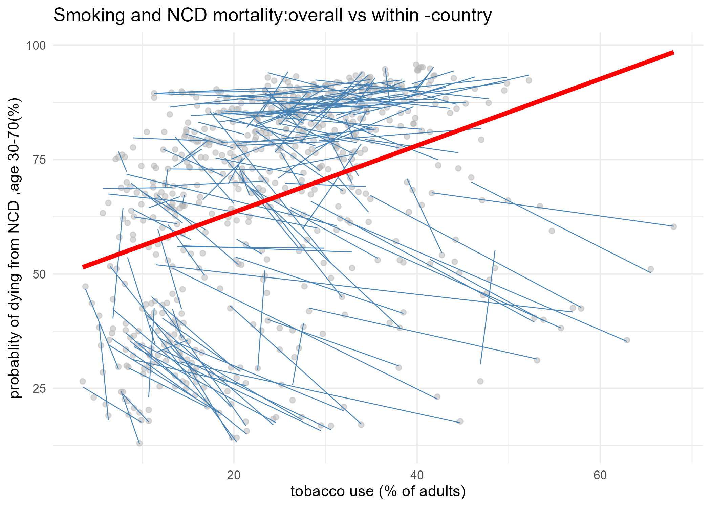
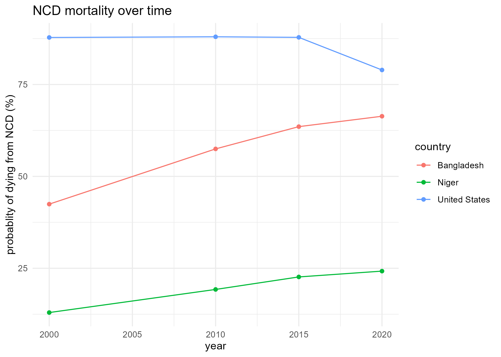

 Global Burden of Non-Communicable Diseases and Risk Factor Analysis

An R analysis of how tobacco use relates to the risk of dying from
non-communicable diseases (NCDs) across countries and years.

## Research question
Is tobacco use associated with the probability of dying from an NCD
(cardiovascular disease, cancer, diabetes or chronic respiratory
disease) between ages 30 and 70?

## Data
| Indicator | Description |
|---|---|
| Tobacco use | Prevalence of current tobacco use (% of adults) |
| NCD mortality | Probability of dying from NCDs, ages 30-70 (SDG 3.4.1) |

- Source: [world bank]
- Years covered: [2000] to [2020]
- Final dataset: 644 country-year observations (both sexes combined)

## Methods
1. Cleaned both datasets and merged them by country and year
2. Explored the relationship with scatter plots and correlation
3. Fitted and compared three linear regression models

## Results
| Model | Predictors | Adjusted R² |
|---|---|---|
| 1 | Tobacco use | 0.13 |
| 2 | Tobacco use + year | 0.18 |
| 3 | Tobacco use + year + country | 0.93 |

## Key findings
- Tobacco use alone explained only about 13% of the variation.
- Adding country raised adjusted R² to 0.93, so differences between
  countries matter most.
- The tobacco coefficient changed from **+0.73 to -0.30** once country
  was controlled for. The overall positive association was driven by
  differences between countries, similar to Simpson's paradox.

## Limitations
- Country-level (ecological) data: results do not show individual
  risk or causation.
- Smoking harms appear after decades, which a short time series may
  not capture.
- Only one risk factor was analysed.

## Files
- `smoke ncd prject.R`: full analysis script
- `chart1.png`, `chart2.png`: figures

## Tools
R, tidyverse, ggplot2

## Author
Samia Selim Sova, Statistics student
